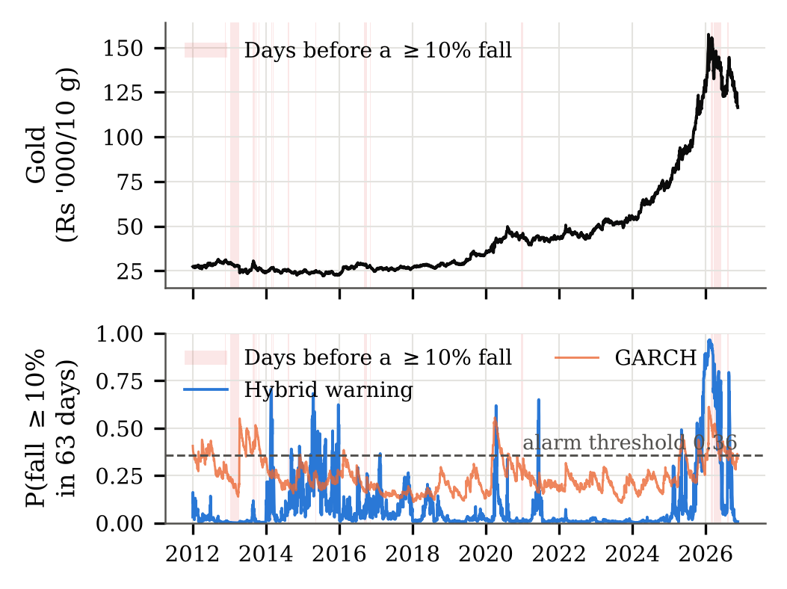
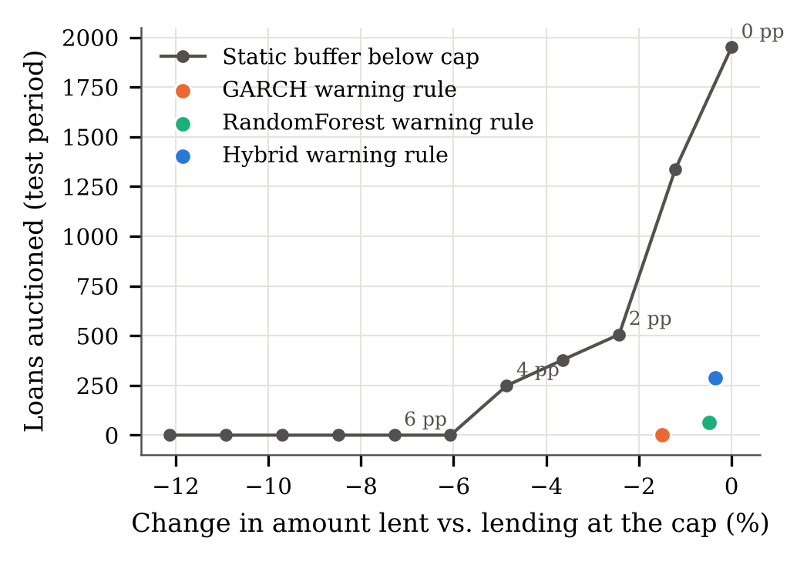

# Early warning for dynamic loan-to-value (LTV) decisions in Indian gold lending

Code, data and paper for **"An Agentic Early-Warning Framework for Dynamic Loan-to-Value Decisions in Indian Gold Lending"** (Vedant Parmar, Shreya Muley, Bishwarup Roy; Goa Institute of Management, AMLBT course project, 2026).

Since 1 April 2026 the RBI lets gold lenders lend up to 85% / 80% / 75% of the gold's value (loans up to Rs 2.5 lakh / Rs 2.5–5 lakh / above), and for bullet loans the LTV includes the interest due at maturity. A fall of about 15% in gold can then wipe out the lender's cushion. This project:

1. predicts, every day, the probability that **gold in rupees falls 10% or more within 63 trading days**;
2. turns the warning into the **LTV offered on new loans** (cut 5 percentage points below the RBI cap when the warning fires);
3. tests the policy on a **simulated book of 1,000,000 bullet loans written on real 2012–2026 prices**;
4. runs the routine with an **agent** that drafts a memo and margin-call notices and waits for a credit manager's approval.



## Key results (all reproduced by `make all`)

**Warning accuracy**, walk-forward 2012-01 to 2026-08 (3,677 out-of-sample days, base rate 7.5%):

| Model | PR-AUC [95% block-bootstrap CI] | ROC-AUC | Brier | Brier skill |
|---|---|---|---|---|
| Base rate | 0.075 | – | 0.071 | 0.000 |
| GARCH(1,1)-t | 0.170 [0.044, 0.375] | **0.656** | 0.098 | −0.381 |
| Logistic regression | 0.149 [0.042, 0.303] | 0.563 | 0.073 | −0.033 |
| Random forest | 0.194 [0.044, 0.441] | 0.574 | 0.072 | −0.013 |
| LightGBM | 0.193 [0.040, 0.416] | 0.552 | 0.073 | −0.024 |
| XGBoost | 0.185 [0.039, 0.416] | 0.537 | 0.073 | −0.030 |
| Ensemble (mean of 4) | 0.218 [0.044, 0.475] | 0.567 | **0.068** | **0.040** |
| **Hybrid: GARCH-anchored LightGBM** | **0.221** [0.040, 0.491] | 0.569 | 0.073 | −0.028 |

**Lending policies**, loans originated 2017–2026 (651,539 loans; rule parameters tuned on 2012–2016 loans only):

| Policy | Amount lent (Rs cr) | vs. cap | Credit loss (Rs cr) | Net profit (Rs cr) | Auctions |
|---|---|---|---|---|---|
| Lend at RBI cap | 7,820.9 | 0.00% | 1.30 | 454.86 | 1,950 |
| Static buffer 2 pp | 7,631.1 | −2.43% | 0.33 | 445.57 | 506 |
| Static buffer 5 pp | 7,346.4 | −6.07% | 0.00 | 429.69 | 0 |
| Warning rule: GARCH | 7,703.5 | −1.50% | 0.00 | 450.64 | 0 |
| Warning rule: Random forest | 7,783.5 | −0.48% | 0.04 | 455.16 | 64 |
| **Warning rule: Hybrid** | 7,793.2 | **−0.35%** | 0.17 | **455.49** | **288** |
| Graded rule: Hybrid | 7,782.9 | −0.49% | 0.22 | 454.72 | 426 |
| Oracle (perfect foresight) | 7,803.6 | −0.22% | 0.03 | 456.25 | 52 |

A static buffer that lends as much as the Hybrid rule would have had about 1,771 auctions. For loans written during the 2025–26 gold boom and bust (Oct 2025 – Aug 2026), lending at the cap led to 1,662 auctions; the Hybrid rule had none.



**Agent:** replayed on the first trading day of each month, Jan 2024 – Nov 2026 (35 runs): its alarm matched the walk-forward decision in 33 runs (94%), all memos passed the numeric grounding check, median 0.23 s per run.

## Repository layout

```
data/raw/               Yahoo Finance snapshot used in the paper (downloaded 17 Nov 2026)
data/processed/         cleaned daily panel (built by the pipeline)
src/goldltv/
  config.py             every setting and assumption in one place
  data.py               load, de-spike and align the series; gold in Rs per 10 g
  features.py           32 leakage-free features and the forward-drawdown label
  models.py             base rate, GARCH(1,1)-t, logistic, RF, LightGBM, XGBoost, ensemble,
                        GARCH-anchored booster; purged expanding-window walk-forward
  metrics.py            PR-AUC, ROC-AUC, Brier, BSS, block bootstrap, episode lead times
  loanbook.py           1M-loan Monte Carlo book under the RBI caps and bullet rule
  policy.py             cap, static buffer, warning rule, graded rule
  pipeline.py           end-to-end experiment -> results/tables, results/figures
  agent.py              daily agent (deterministic or Claude-driven) with approval gate
  webapp.py             approval page for the credit manager (FastAPI)
scripts/fetch_data.py   refresh data from Yahoo Finance
scripts/evaluate_agent.py  monthly replay of the agent
tests/                  leakage, label and policy unit tests
results/                predictions, tables (CSV) and figures (PDF/PNG)
(the paper itself is kept in the team's Overleaf project)
```

## Reproduce

Python 3.13 on Linux was used (exact versions in `requirements-lock.txt`).

```bash
git clone https://github.com/Mazeker/gold-loan-ltv-early-warning.git
cd gold-loan-ltv-early-warning
pip install -r requirements.txt
make test          # 4 unit tests
make experiments   # about 2-3 minutes on 4 cores; rebuilds results/
make agent         # today's agent note in agent_outbox/pending/ + the 35-run replay
```

Optional:

```bash
make data                                         # refresh the Yahoo Finance snapshot
cd src && python -m goldltv.agent --mode llm      # Claude plans the tool calls and writes the memo
cd src && uvicorn goldltv.webapp:app --port 8000  # approval page at http://localhost:8000
```

The LLM mode uses the Anthropic SDK (`ANTHROPIC_API_KEY`, model `claude-opus-5-5`) and falls back to the deterministic mode if no credential is available. In every mode the LTV comes from the rule, not from the language model, and nothing is sent to customers.

## Method in brief

* **Target:** `Y_t = 1` if `min_{k=1..63} P_{t+k}/P_t − 1 ≤ −10%`, where `P_t` = COMEX gold × USD/INR in Rs per 10 g. Robustness targets: (21 d, 5%), (42 d, 8%), (126 d, 15%).
* **Validation:** refit every 1 January 2012–2026 on an expanding window; training rows whose label window overlaps the test year are purged.
* **Hybrid model:** LightGBM trained with `init_score = logit(GARCH probability)`, so it learns corrections on top of the volatility forecast.
* **Policy:** `LTV = RBI cap − 5 pp` on days when the warning ≥ τ; τ and the cut are chosen to maximise net profit on 2012–2016 loans only.
* **Loan book assumptions** (in `config.py`): tenures 3/6/12 months (30/50/20%), lognormal size (median Rs 80,000), rates 22/18/15% by slab, funding cost 9%, auction haircut 5% plus Rs 5,000 per auction, borrowers default only when the gold is worth less than the amount due.

## Data sources and limitations

All inputs are public daily series from Yahoo Finance: GC=F, SI=F, INR=X, CL=F, DX-Y.NYB, ^VIX, ^TNX, ^GSPC, ^NSEI, ^INDIAVIX, TIP and GLD. Yahoo data is for research use; check its terms before redistribution in other settings.

The loan book is simulated because loan-level gold-loan data is not public. The gold price excludes Indian import duty and GST. The TIPS ETF stands in for US real yields. See Section V of the paper for the full list.

## License

Code: MIT (see `LICENSE`). Paper text © the authors.
